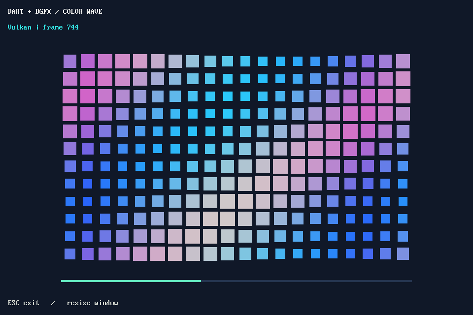

# bgfx

Dart bindings for the official [bgfx C99 API](https://bkaradzic.github.io/bgfx/bgfx.html), following cave's MuJoCo and ONNX Runtime Native Assets integration.

```dart
import 'package:bgfx/bgfx.dart';
```

The initial API exposes generated C functions, structs, enums and `BGFX_*` constants directly. There is no windowing dependency or high-level scene API. Applications provide native window/display handles through `bgfx_init_t.platformData` before initialization. Shader compilation tools and Flutter texture integration are outside this package's current scope.

## Run

Requires Dart 3.13+, xmake, a C++ toolchain, and network access on the first build. Linux additionally needs X11 and OpenGL development libraries even for the Noop smoke example, since the binary includes GPU backends.

From this package directory:

```sh
dart pub get
dart run example/native_smoke.dart
dart test
dart run tool/verify_native_assets.dart
```

The smoke example initializes the Noop renderer without a display or GPU, submits two frames, checks the frame counter and shuts down. It calls `bgfx_render_frame(-1)` before initialization to keep rendering on the calling thread. Keep bgfx API calls synchronous on the API thread; do not move a context between isolates or use async gaps to drive it without arranging native thread affinity. Use `bgfx_init_ctor` to initialize defaults before overriding fields; zero-initialization alone is insufficient. Native pointers and renderer resources require explicit ownership and cleanup.

The AOT verification script checks a used-native bundle executes successfully and an unused import produces no bgfx library. Artifacts are written under `.dart_tool/native_assets_check/`.

## Window example (Linux/X11)

```sh
dart run example/window.dart
# Render a fixed number of frames, then close cleanly:
dart run example/window.dart --frames=120
```

Opens a 960×640 window showing an animated color wave and debug text. Resize the
window to adapt the scene; press Esc or close the window to exit. bgfx selects
an available GPU backend (Vulkan on the validation machine). Requires an X11
session or XWayland, `DISPLAY`/Xauthority access, `libX11.so.6`, `libXext.so.6`,
and a working graphics driver. No extra Dart packages or shaderc are required.

The scene uses separate bgfx view rectangles and color clears, plus bgfx's
built-in debug font. It demonstrates window handles, rendering, resize/reset,
event polling and cleanup; it is not a vertex/shader or 3D mesh example.
Xext is kept loaded so its X11 display callbacks remain valid after renderer
shutdown. The frame loop stays synchronous to preserve native thread affinity.



The small example-only X11 binding is generated from the system Xlib headers:

```sh
dart run tool/ffigen_x11.dart
```

Regeneration needs X11 development headers (`libx11-dev` on Debian/Ubuntu).
The Xlib license is included in `third_party/x11/LICENSE`; these bindings are
not exported by `package:bgfx/bgfx.dart`.

## Build and bindings

- bgfx 9392: `34deeda1094ade66bc48215d3a276e7cce547c0c`.
- bx: `43bfe2940275ef7fa5bc362814883d5252715122`.
- bimg: `3b4baab0128ac499c5c3bc37202781bf54084049`.

`hook/build.dart` and `hook/link.dart` share an `XmakeLibrary` with `.byPreference`: shared native assets for development and a merged static archive for AOT. The local recipe merges bgfx, bimg and bx and preserves C API visibility. The link hook retains the C symbols recorded by ffigen and adds platform runtime libraries. See [recipe notes](xmake_repo/README.md).

Vendored headers in `third_party/bgfx/` match those pinned revisions. Regenerate bindings with:

```sh
dart run tool/ffigen.dart
dart analyze
```

Variadic debug-text functions and the alternate interface vtable accessor are excluded; use `bgfx_dbg_text_image` or fixed argument APIs. The C enum tag `bgfx_render_frame` is generated as `BgfxRenderFrame` to preserve the function's original name. FFIgen reports its usual C enum ABI warning; builds must use the compiler's default enum representation (no `-fshort-enums`). The opaque encoder warning is expected.

Linux x64 is the validation target. Other recipe platforms require target-device verification. Android and Web are not supported by this recipe. The window example has also been exercised with Vulkan on Linux x64; other GPU backends and platforms still require verification.

The Dart integration is MIT licensed. bgfx, bx and bimg retain their upstream BSD-2-Clause licenses; see `third_party/bgfx/` for redistribution notices.
